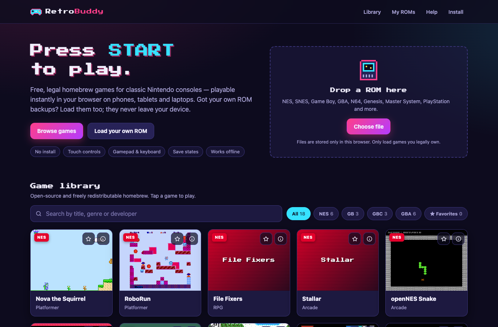
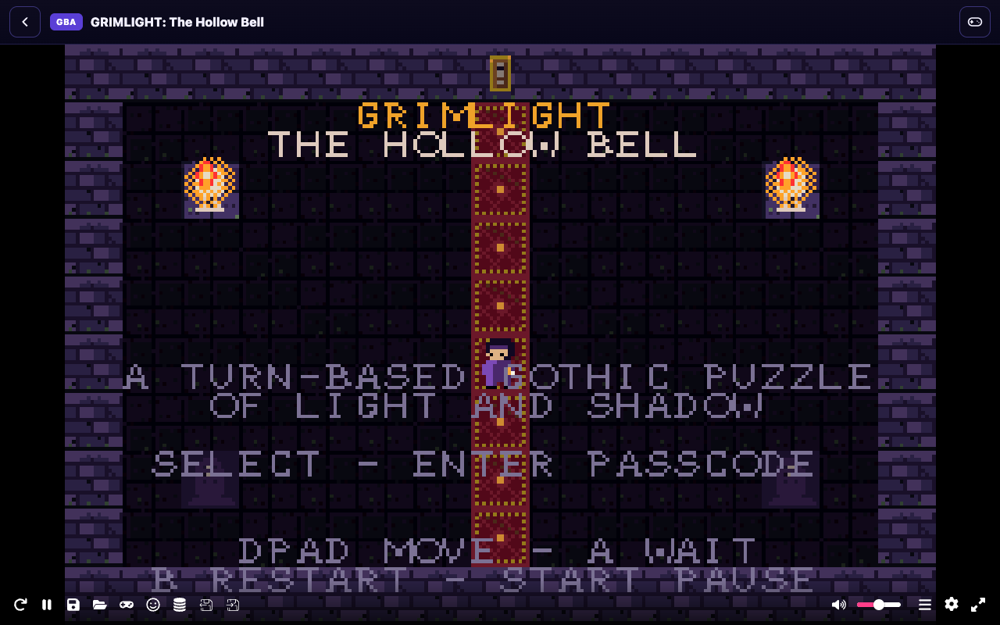
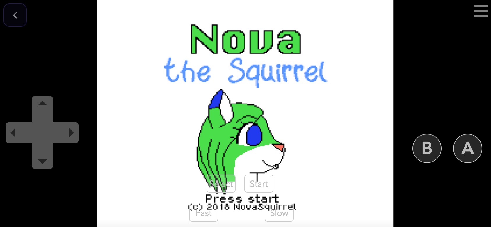

# RetroBuddy

**Play retro games in any browser: phones, tablets and laptops. No installs, no accounts, no ads.**

RetroBuddy is a fast, installable web app that ships with a library of **18 free, legally redistributable homebrew games** for NES, Game Boy, Game Boy Color and Game Boy Advance. It also lets players **load their own ROM files** for 20+ classic systems. It is a 100% static site, so it deploys for free on **GitHub Pages** or **Vercel**.



| Playing on desktop | Playing on a phone (landscape) |
| --- | --- |
|  |  |

## Features

- **Instant play**: tap a game and press Start. Emulation runs entirely in the browser via WebAssembly ([EmulatorJS](https://emulatorjs.org) / libretro cores).
- **Every device**: an on-screen touch gamepad on phones and tablets, keyboard on laptops, and plug-and-play USB/Bluetooth controllers (Xbox, PlayStation, Switch Pro, 8BitDo…).
- **Legal library**: only open-source / freely licensed homebrew games are bundled, each with credits, license and source link.
- **Bring your own ROM**: drag and drop or pick files for NES, SNES, GB/GBC, GBA, N64, NDS, Genesis, Master System, Game Gear, 32X, PlayStation, PC Engine, Atari, Neo Geo Pocket, WonderSwan and more. ROMs are stored **only in your browser** (IndexedDB) and never uploaded.
- **Saves**: in-game saves persist automatically; save states, fast-forward, rewind, cheats, shaders and control remapping are in the emulator menu.
- **Library tools**: search, system filters, favorites, and a "Continue playing" row.
- **Installable & offline**: a Progressive Web App with a service worker. Once a game has been played, it works without a connection.
- **Hardened**: a strict Content Security Policy, a version-pinned emulator runtime, no third-party trackers, and no cookies.
- **Tested**: unit tests, catalog/ROM validation and a headless-Chrome end-to-end suite that boots every bundled game.

## Quick start

Requirements: **Node.js 18+** (only for the dev server and tests; the site itself has no build step).

```bash
git clone https://github.com/ijazahamed108/RetroBuddy.git
cd RetroBuddy
npm start                  # http://localhost:8080/
```

Other useful commands:

| Command | What it does |
| --- | --- |
| `npm start -- --base /RetroBuddy/` | Serve under a sub-path, exactly like GitHub Pages |
| `npm start -- --host 0.0.0.0` | Make the dev server reachable from a phone on the same Wi-Fi |
| `npm test` | Unit tests + catalog validation tests (no dependencies) |
| `npm run validate` | Check `games/games.json`, ROM headers, covers and licenses |
| `npm install && npm run test:e2e` | Headless Chrome smoke test (set `ALL_GAMES=1` to boot every game) |

> Any static file server works too, e.g. `python3 -m http.server 8080`.

## Deploy for free

The repository root **is** the website. Nothing needs compiling.

- **GitHub Pages**: *Settings → Pages → Deploy from a branch → `main` / `(root)`*. The site is live at `https://<user>.github.io/RetroBuddy/`.
- **Vercel**: *Add New → Project → import this repo*, framework preset **Other**, leave the build command empty, output directory `.`. `vercel.json` adds security and caching headers.

Full step-by-step instructions, custom domains and update procedures are in **[docs/DEPLOYMENT.md](docs/DEPLOYMENT.md)**.

## Documentation

| Guide | For |
| --- | --- |
| [User guide](docs/USER_GUIDE.md) | Players: controls, mobile tips, saves, loading your own ROMs, troubleshooting |
| [Deployment guide](docs/DEPLOYMENT.md) | Publishing on GitHub Pages or Vercel, custom domains, releasing updates |
| [Adding games](docs/ADDING_GAMES.md) | Maintainers: adding a homebrew game to the library, the license checklist, the catalog schema |
| [Credits](CREDITS.md) | Authors and licenses of every bundled game and component |

## Project structure

```
RetroBuddy/
├── index.html              # Library page (search, filters, favorites, My ROMs)
├── play.html               # Player page (hosts the emulator)
├── 404.html                # Not-found page (GitHub Pages & Vercel)
├── sw.js                   # Service worker: offline shell, ROM + emulator caching
├── manifest.webmanifest    # PWA metadata (install to home screen)
├── vercel.json             # Headers for Vercel (also applied by the dev server)
├── assets/
│   ├── css/                # main.css (site), play.css (player)
│   ├── js/
│   │   ├── app.js          # Library UI
│   │   ├── play.js         # Player bootstrap → EmulatorJS
│   │   ├── systems.js      # Supported systems, file extensions → emulator core
│   │   ├── catalog.js      # Loads games/games.json
│   │   ├── storage.js      # IndexedDB (custom ROMs) + localStorage (favorites, recents)
│   │   ├── pwa.js          # Service worker registration + install button
│   │   └── util.js         # Small DOM helpers
│   ├── covers/             # Game screenshots used as cover art
│   ├── fonts/              # Press Start 2P (SIL OFL)
│   └── icons/              # Favicon and PWA icons
├── games/
│   ├── games.json          # The game catalog
│   ├── nes/  gb/  gba/     # Bundled homebrew ROMs
├── scripts/
│   ├── serve.mjs           # Zero-dependency dev server
│   └── validate-catalog.mjs
├── tests/                  # node:test unit tests + e2e/smoke.mjs (Puppeteer)
└── docs/                   # Guides and screenshots
```

## How it works

1. `index.html` loads `games/games.json` and renders the library. Custom ROMs are read from IndexedDB.
2. Choosing a game opens `play.html?game=<id>` (bundled) or `play.html?rom=<uuid>` (custom).
3. `play.js` resolves the ROM, maps its system to an EmulatorJS core (`systems.js`), sets the `EJS_*` configuration and loads EmulatorJS **v4.2.3** from `cdn.emulatorjs.org` (version-pinned).
4. EmulatorJS downloads the matching libretro core (WebAssembly), boots the game, and renders the touch gamepad on mobile.
5. `sw.js` caches the app shell, the ROMs you have played and the emulator runtime, so games keep working offline.

## Legal

- RetroBuddy **does not host, link to or help obtain commercial ROMs**. Games like Super Mario Bros., Contra or Sonic are copyrighted. Only load ROMs you have the legal right to use (for example, backups of cartridges you own, where your local law allows it).
- Every bundled game is open source or explicitly freely licensed. Authors, licenses and source code links are listed in [CREDITS.md](CREDITS.md) and in each game's info panel.
- Nintendo, Game Boy, Sega, Genesis, PlayStation and other names are trademarks of their respective owners. RetroBuddy is not affiliated with or endorsed by them.

## License

RetroBuddy's own source code is released under the [MIT License](LICENSE). Bundled games, the emulator and the font keep their own licenses (see [CREDITS.md](CREDITS.md)).
